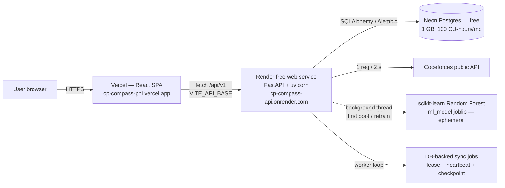

# Rung — Architecture

## System diagram

## Request flow

1. The SPA calls `VITE_API_BASE + /api/v1/...` with a JWT access token
   (15 min). A 401 triggers one refresh-token retry, then logout.
2. The API reads/writes Postgres through SQLAlchemy. Schema is managed by
   Alembic; migrations run automatically at backend startup.
3. Sync is a DB-backed job queue, not BackgroundTasks: a worker loop leases
   a job, pages the Codeforces API (max 1 req/2s), saves each batch, and
   checkpoints the last submission ID. Startup recovers stale jobs.
   One sync per user at a time (a second sync returns 409).
4. Recommendations are scored rule-first
   (`0.35W + 0.30D + 0.20R + 0.15P`, 0–100). The ML model adds a solvability
   % on top; it never replaces the score.
5. The demo (`/demo`) serves seeded data from the same read paths and
   rejects every write.

## Free-tier limits (verified Nov 2026)

| Service | Free allowance | What happens at the limit |
|---|---|---|
| Neon Postgres (Free) | 100 CU-hours/project/mo, 1 GB storage/project (20 GB total), 5 GB egress, scale-to-zero after 5 min idle, no card, no expiry | Compute suspended until next billing period; inserts fail past the storage cap |
| Render web service (Free) | 750 instance hrs/workspace/mo, 512 MB RAM, spins down after 15 min idle, ~1 min cold start, 500 build min/mo | Services suspended until next month when hours run out |
| Vercel (Hobby) | 100 GB transfer/mo, 1M CDN requests, 1M function invocations, 200 projects, 100 deploys/day; personal, non-commercial use only | No paid overage — the feature pauses until the 30-day window resets |

Notes:

- Render's free Postgres is **not** used: it expires 30 days after creation
  (official docs; some third-party reports say ~90 days in practice).
  Neon Free has no expiry.
- Render's filesystem is ephemeral: `ml_model.joblib` is not persisted
  across restarts — the backend retrains in a background thread on boot
  when no artifact exists (small dataset, a few seconds).
- The backend sleeps on Render after 15 idle minutes; the frontend shows a
  "Waking up the server" banner on the first request after a sleep.
- Backups: Neon Free keeps a 6-hour restore window. Take a periodic
  `pg_dump` for anything beyond that.
